# Smart Attendance System

A contactless attendance system for classrooms. Every teacher scans a finger at the classroom door, a camera on the classroom wall photographs the students at random moments during the lecture, and **face recognition marks each student present or absent** — straight into a database that students and faculty check on a website.

**B.E. Electronics & Telecommunication · VCET, University of Mumbai · Team Innovative_Heads**<br>
1st place at Oscillations'23 · 2nd prize at Tech-A-Thon'23, VNPS'23 and Electrowiz 2023 · [All awards](#awards)

[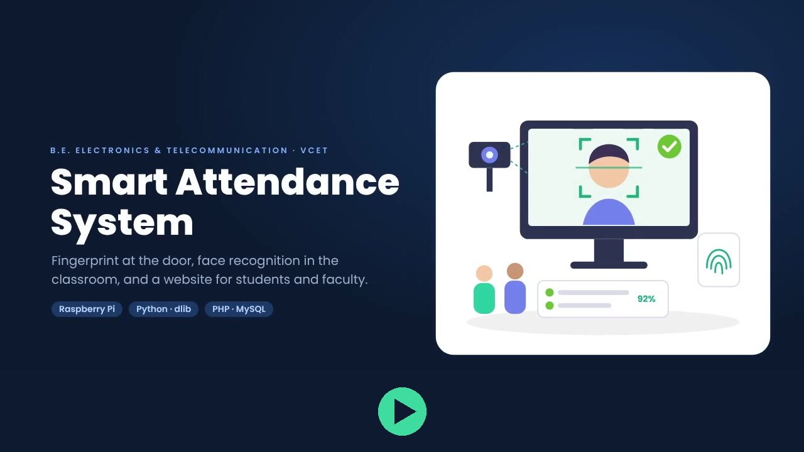](docs/videos/smart-attendance-explainer.mp4)

*Click to watch the narrated explainer (2 min 41 s, sound on, captions included): the problem, the door sensor and wall camera, how the face matching works, and the website for students and faculty.*

## The problem

Calling names takes several minutes of every lecture, and a friend can answer "present" for someone who isn't there. ID cards can be lent, and a fingerprint scan for every student means a queue and physical contact. Even when attendance is taken properly at the start, a student can be marked present and then walk out a few minutes later.

## What it does

- **Knows which lecture is on.** A fingerprint sensor sits outside the classroom door. Each teacher scans a finger on the way in; every enrolled finger belongs to a subject, so the system knows which subject's lecture has started, and the LCD above the sensor greets the teacher.
- **Watches the whole lecture, not just the start.** A camera on the classroom wall takes photos of the full class at random moments spread over the lecture (six in an hour by default). Nobody can predict when the next photo comes.
- **Recognises every face.** Faces are found with HOG detection, turned into 128-number face embeddings (dlib) and matched to the students' roll numbers.
- **Counts only real presence.** A student is **present** only if recognised in at least 60 % of the photos. Someone who is marked and then leaves, or arrives very late, ends up **absent** — and the teacher can see they were in "2 of 6 photos".
- **Saves everything at once.** The result is written to MySQL after every photo, and the LCD counts down the lecture.
- **Gives students a dashboard.** Attendance in every subject, a lecture-by-lecture record, an analytics chart with a warning below 75 % or 50 %, leave applications to faculty, and alerts.
- **Gives faculty the whole class.** Each student's percentage and early departures, corrections (for example an approved leave), announcements, leave requests, and a CSV download that opens in Excel. A Python tool also writes a day's attendance to an Excel workbook, one sheet per subject.

## How it is set up

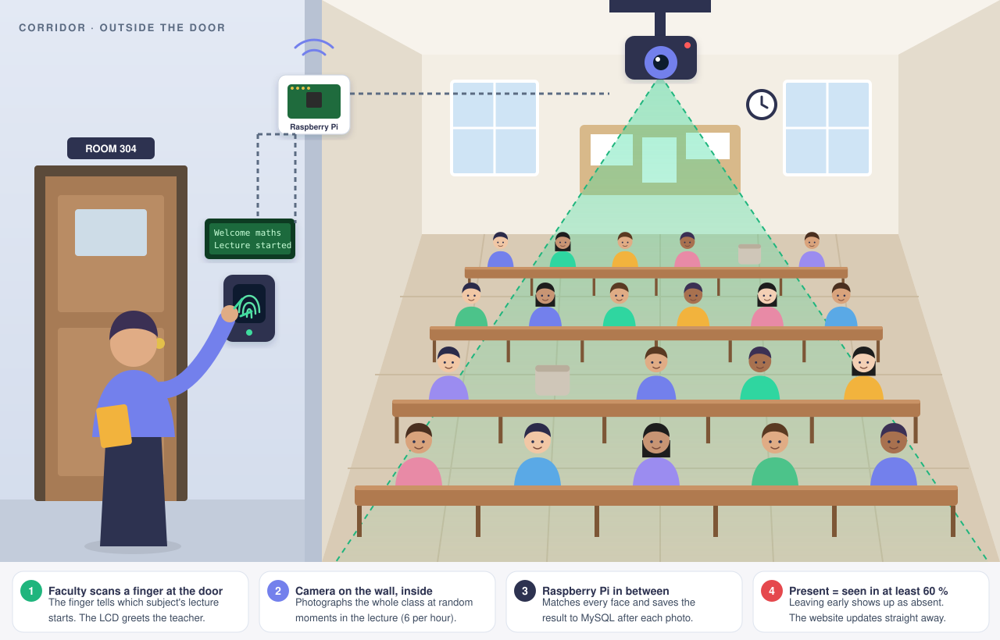

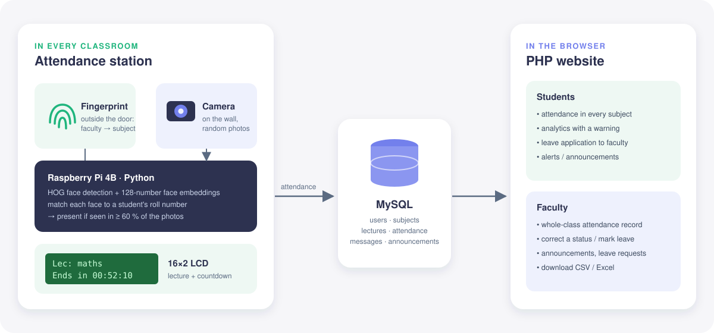

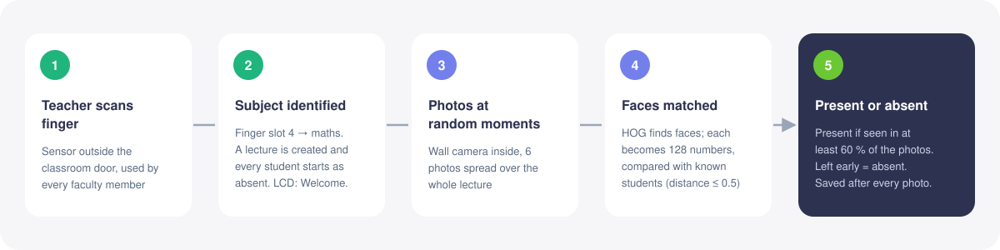

More detail: [architecture](docs/architecture.md) · [database tables](docs/architecture.md#database) · [hardware wiring](docs/architecture.md#hardware)

## Screenshots

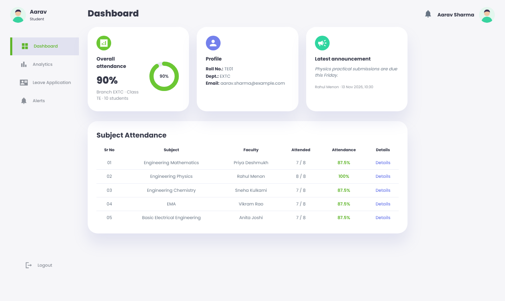

*Student dashboard. All screenshots show the website running with made-up demo data.*

| Analytics with a low-attendance warning | Faculty: attendance list with early departures |
| --- | --- |
| 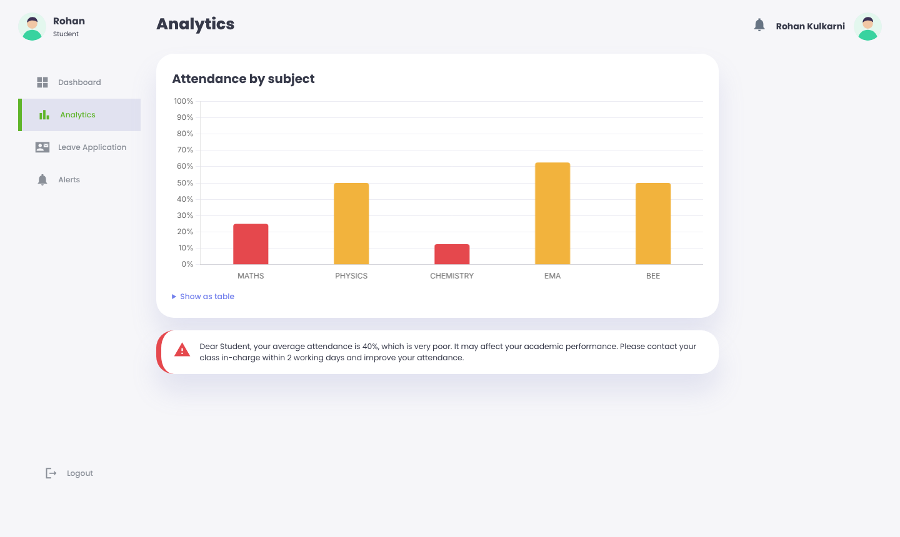 | 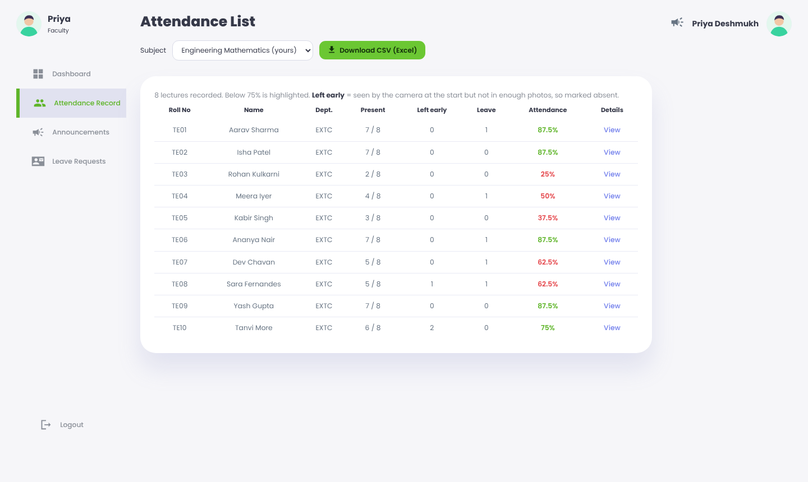 |
| **Subject page: how often the camera saw the student** | **Leave application to a teacher** |
| 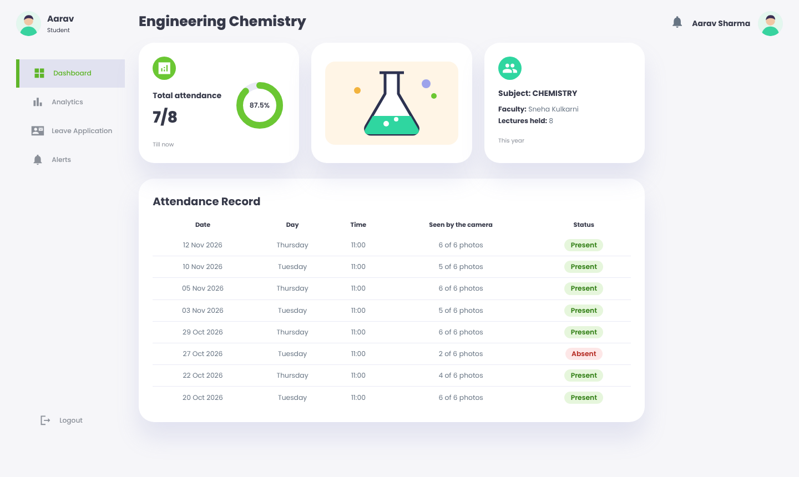 | 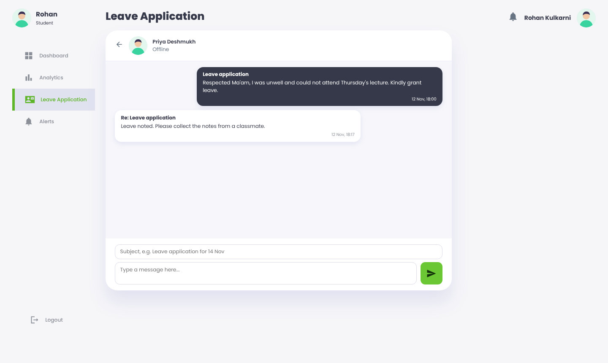 |

## Hardware

| Part | Where | Used for |
| --- | --- | --- |
| Optical fingerprint sensor (R30x family, 508 DPI, 200 templates) + USB-to-serial adapter | Outside the classroom door | Teacher authentication → which subject |
| 16×2 LCD with I2C backpack | Above the sensor | Welcome message and lecture countdown |
| Camera module, 8 MP Sony IMX219 (or a USB webcam) | On the front wall, facing the students | Photos of the whole class |
| Raspberry Pi 4B | In a box on the wall between them | Face matching, database, station control |

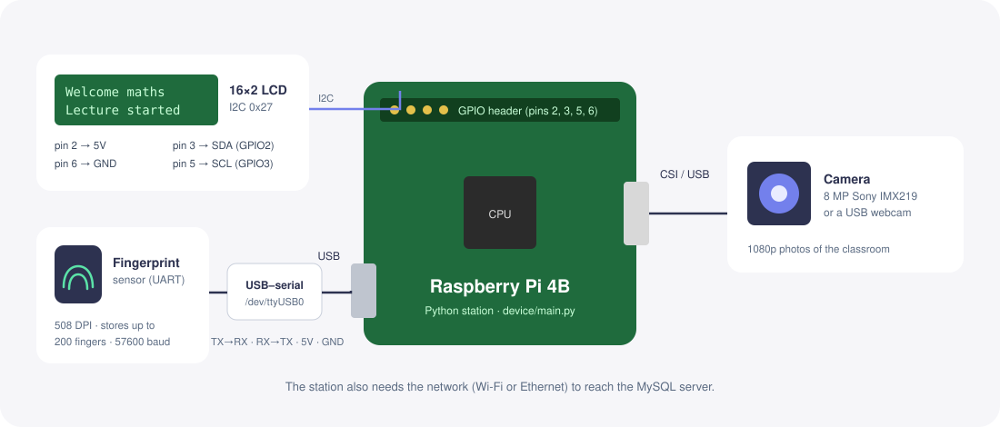

## Run it on your computer

You need **PHP 8.1+** with `pdo_mysql`, **MySQL 8 or MariaDB**, and **Python 3.10+**. XAMPP on Windows has the first two.

```bash
git clone https://github.com/MayankP2811/smart-attendance-system.git
cd smart-attendance-system
cp .env.example .env                       # then set DB_PASSWORD
mysql -u root -p < database/create_database.sql      # set the same password in this file first
mysql -u root -p smart_attendance < database/schema.sql
mysql -u root -p smart_attendance < database/demo_data.sql   # made-up demo people
./scripts/run_local.sh                     # website on http://127.0.0.1:8000
```

Log in with **aarav.sharma@example.com** (role Student) or **priya.deshmukh@example.com** (role Faculty). Every demo password is `Demo@123`.

**Simulate a lecture without any hardware** (keyboard instead of the fingerprint sensor, terminal instead of the LCD). Here one student leaves early:

```bash
python3 -m venv .venv && .venv/bin/pip install -r requirements.txt
.venv/bin/python -m device.main --mock --finger 4 --present TE01,TE02,TE05 --leave-early TE03 --lecture-seconds 30
```

Refresh the faculty page: the new maths lecture shows TE01, TE02 and TE05 present, and TE03 absent after being seen in only the first photos. With `requirements-face.txt` installed you can run the **real face matching** on your own photos with `--images path/to/classroom/photos` (see [setup](docs/setup.md#face-recognition)).

There is also a `docker-compose.yml` for a one-command start (`docker compose up -d`, then http://localhost:8080). Step-by-step guides for XAMPP, Docker and the Raspberry Pi: **[docs/setup.md](docs/setup.md)**.

**Run the tests** (database tests need MySQL/MariaDB and are skipped without it):

```bash
.venv/bin/pip install -r requirements-dev.txt
.venv/bin/python -m pytest
```

## Future scope

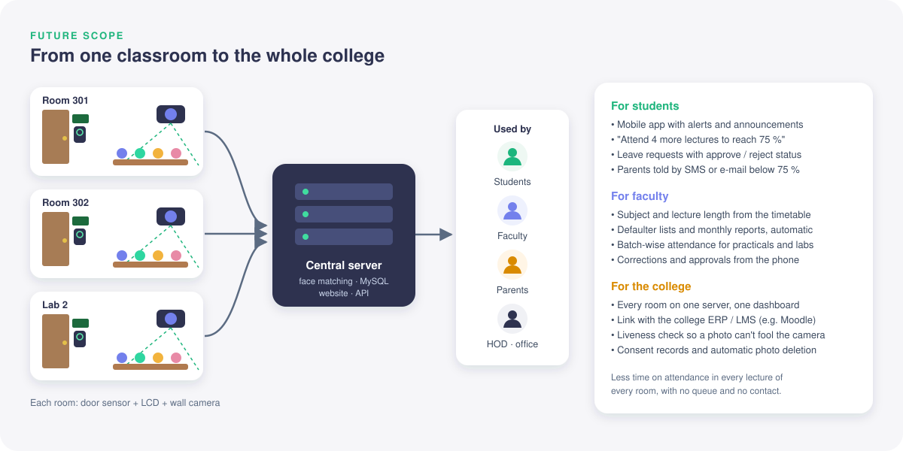

The same idea scales from one classroom to the whole college: a door sensor, LCD and wall camera in every room, all sending to one central server. Every lecture in every room then saves the minutes spent on attendance, with no queue and nothing to touch, for students and faculty alike.

| For students | For faculty | For the college |
| --- | --- | --- |
| Mobile app with push alerts and announcements | Subject and lecture length taken from the timetable, including substitute lectures | Every classroom and lab on one server, with one dashboard for the department |
| "Attend 4 more lectures to reach 75 %" planner | Defaulter lists and monthly reports generated and e-mailed automatically | Link with the college ERP or LMS (for example Moodle) |
| Leave requests with approve / reject status that update attendance | Batch-wise attendance for practicals and labs | Liveness check so a printed photo can't be marked present |
| SMS or e-mail to parents when attendance drops below 75 % | Approve leave and correct attendance from a phone | Consent records and automatic deletion of photos |

## Awards

| Event | Result |
| --- | --- |
| Oscillations'23 — technical paper presentation, VCET with IETE Mumbai Centre (17 March 2023) | **1st place** |
| Tech-A-Thon'23 — 48-hour hardware hackathon, Thadomal Shahani Engineering College (certificate dated 1 April 2023) | **2nd position** |
| VNPS'23 — VCET National Level Project Showcase (6 April 2023) | **2nd prize** |
| Electrowiz 2023 — national level project competition, Datta Meghe College of Engineering, IETE-DMCE (21 April 2023) | **2nd prize** and ₹1,000 |

[Certificates](docs/evidence/achievements.pdf) · [The team's paper and presentation](docs/research.md)

## Repository layout

| Path | Contents |
| --- | --- |
| `device/` | Raspberry Pi station: `main.py`, `station.py` (the lecture loop), `face.py`, `hardware.py`, `db.py`, `config.py` |
| `device/tools/` | Enroll fingerprints, build face encodings, export Excel |
| `web/` | PHP website: pages, `includes/` (database, login, roles, attendance maths), `api/`, `cli/create_user.php`, `assets/` |
| `database/` | `schema.sql`, made-up `demo_data.sql`, `create_database.sql` |
| `tests/` | Station tests (fake hardware) and website tests (real PHP + MySQL) |
| `docs/` | Setup, architecture, test status, Pi checklist, paper summary, certificates, images and video |
| `scripts/` | Local run script, demo-data generator, classroom illustration generator |

## Privacy

Face photos and face encodings are **biometric personal data**. None are included in this repository, and `.gitignore` keeps `dataset/` and `device/data/` out of git. Only enroll students who have agreed, store the encodings on the station or the college server, and delete them when a student leaves. See [docs/assessment.md](docs/assessment.md#privacy).

## Team

**Mayank Patil** (team leader) · **Omkar Joshi** · **Chandan Thakur** · **Parth Mhatre** — Team Innovative_Heads<br>
Co-authors of the paper *Smart Attendance System using Face Recognition Method*: Mayank Patil, Chandan Thakur, Omkar Joshi, Manthan Patil.

Mayank Patil maintains this repository.

---

[Setup](docs/setup.md) · [Architecture](docs/architecture.md) · [Test status](docs/assessment.md) · [Third-party credits](THIRD_PARTY_NOTICES.md) · [MIT License](LICENSE)
