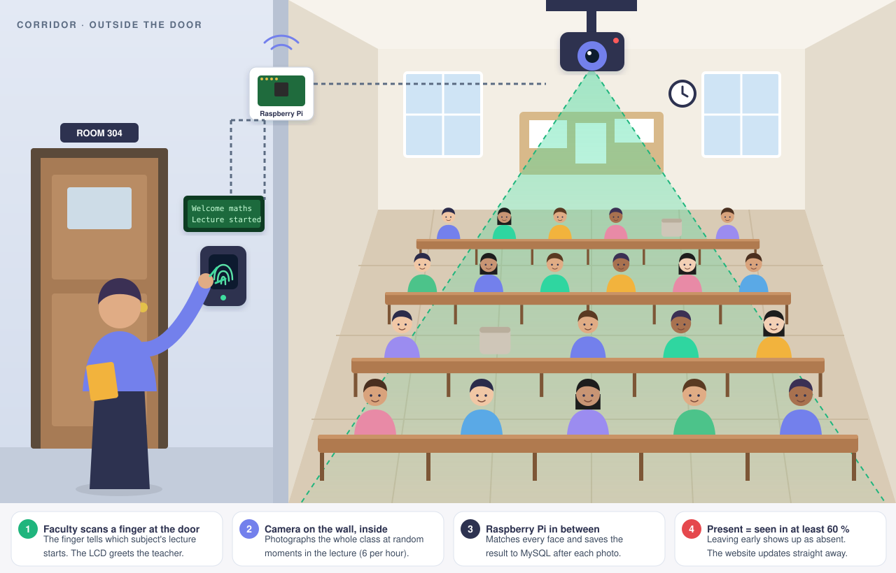
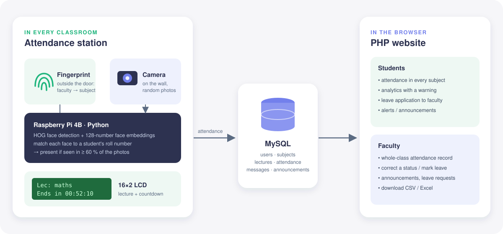
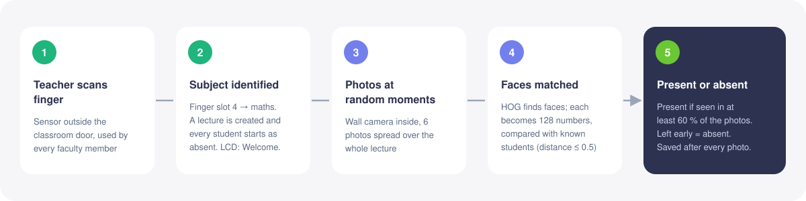
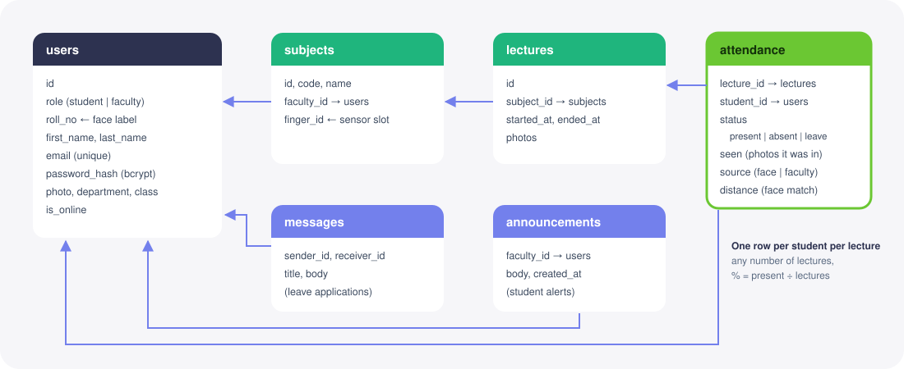
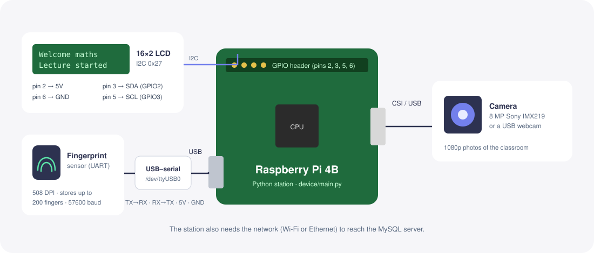
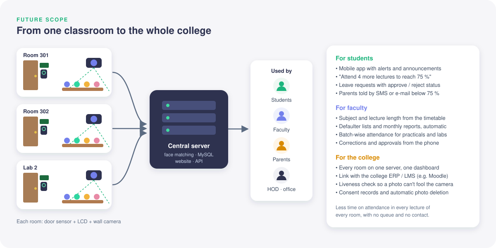

# Architecture

The project has two programs that share one MySQL database:

| Part | Runs on | Language | Job |
| --- | --- | --- | --- |
| **Attendance station** (`device/`) | Raspberry Pi in the classroom | Python | Door fingerprint → subject → photos during the lecture → face matching → attendance rows |
| **Website** (`web/`) | Any PHP server (XAMPP, Apache, `php -S`) | PHP 8 | Students and faculty read and manage the attendance |

They never call each other. The station writes, the website reads (and lets faculty correct).

## Where each part sits

| Part | Place | Why there |
| --- | --- | --- |
| Fingerprint sensor + LCD | Outside the classroom door, at hand height | Every teacher passes it on the way in, so the lecture is identified without anyone having to remember a step |
| Camera | On the front wall, above the board, facing the students | Sees every row and every face for the whole lecture |
| Raspberry Pi | In a box on the wall between the door and the camera | Short cables to both, and the network (Wi-Fi or Ethernet) to reach MySQL |

## One lecture, step by step

`device/station.py` — `Station.run_once()`:

1. **Wait for a finger.** `FingerprintSensor.wait_for_finger()` polls the sensor every 0.1 s and returns the slot number of the matched template.
2. **Find the subject.** `subjects.finger_id` maps the slot to a subject (slot 4 → maths in the demo data). An unknown finger or an unlinked slot shows a message on the LCD and the station waits again.
3. **Create the lecture.** One `lectures` row with the current time, plus one `attendance` row per student with status `absent` and `seen = 0`. Committed straight away. The LCD shows "Welcome maths".
4. **Plan the photos.** `capture_times()` cuts the lecture (`LECTURE_MINUTES`, 60) into `CAPTURE_COUNT` equal parts (6) and picks one random moment inside each part. Every part of the lecture is covered, but the exact times change every lecture, so students can't predict them.
5. **Count down and take photos.** Once a second the LCD shows `Lec: maths / Ends in 00:52:10`. When a planned moment arrives, the camera takes a photo of the class. A failed camera read is logged and skipped; it doesn't stop the lecture.
6. **Match faces.** For each photo, `FaceRecognizer.identify()`:
   - converts OpenCV's BGR image to RGB,
   - finds faces with dlib's **HOG** detector (`FACE_MODEL=hog`, `FACE_UPSAMPLE=1`),
   - turns each face into a **128-number embedding**,
   - compares it with every known embedding (Euclidean distance) and takes the closest student if the distance is ≤ `FACE_TOLERANCE` (0.5),
   - gives each student to at most one face per photo (the closer one wins).
7. **Update attendance after every photo.** `AttendanceDB.record_photo()` adds 1 to `seen` for every recognised student, keeps their best (smallest) face distance, and sets the status of the whole class: **present** if `seen` ≥ `MIN_PRESENCE` × photos so far (60 %: 4 of 6), otherwise **absent**. A status the teacher has set (a leave, or a correction) is never changed by the camera. Everything is committed at once, so a power cut keeps what was already seen.
8. **End the lecture.** After `LECTURE_MINUTES`, `ended_at` is saved, the LCD shows how many students were present, and the station waits for the next finger.

### Why these choices

- **Photos through the whole lecture.** A single roll call at the start can't tell who stays. Photos at random moments, and a rule that counts how often each student was seen, make "mark attendance and walk out" show up as absent — while a student who is hidden in one photo still counts.
- **A threshold, not "seen once".** Face detection occasionally misses someone who looks down. Requiring 60 % of the photos (not 100 %) tolerates that, and the faculty page shows "seen in 2 of 6 photos" so a teacher can judge borderline cases. Both `CAPTURE_COUNT` and `MIN_PRESENCE` can be changed in `.env`.
- **Face embeddings, not a trained classifier.** Adding a student only needs their photos and a re-run of `build_encodings`; nothing has to be retrained. This is the method described in the team's paper (HOG detection + deep metric learning, 128-d embeddings).
- **`.npz` for the known faces**: loaded with `allow_pickle=False`, so the file can't run code when it is opened.
- **Mock hardware** (`MockFingerprint`, `MockCamera`, `ConsoleDisplay`, `SimulatedRecognizer`) so the full loop can be run and tested on any computer. The real classes import their hardware libraries only when created.

## Database

`database/schema.sql`. The key table is `attendance`: **one row per student per lecture**.

| Table | Holds |
| --- | --- |
| `users` | Students and faculty. `roll_no` links a student to their face photos. Passwords are bcrypt hashes. |
| `subjects` | Code, name, teacher (`faculty_id`) and the fingerprint slot that starts its lecture (`finger_id`). |
| `lectures` | One row per lecture: subject, start and end time, how many photos were taken. |
| `attendance` | `present`, `absent` or `leave` for each student in each lecture, in how many photos they were seen, who set the status (`face` or `faculty`) and the best face distance. |
| `messages` | Leave applications and replies between a student and a teacher. |
| `announcements` | Faculty announcements, shown to students as alerts. |

With one row per student per lecture, a subject can have any number of lectures, adding a subject is one row, statuses can only be `present`, `absent` or `leave`, and students are linked by roll number.

**Percentages.** `web/includes/attendance.php` is the only place that calculates them, so every page shows the same number:

- subject % = lectures marked *present* ÷ lectures the student was enrolled for
- overall % = average of the subject percentages (subjects with no lectures yet are left out)
- the analytics message: below 50 % "very poor", 50–75 % "moderate", 75 % and above "good"
- "left early" on the faculty page = lectures where the student was seen in some photos but not enough to be present

## Website

| Page | Who | What |
| --- | --- | --- |
| `login.php`, `signup.php` | everyone | Login with role; student registration (photo optional) |
| `student.php` | student | Overall ring, profile, latest announcement, subject table |
| `subject.php?code=` | student | Every lecture of a subject: date, photos seen in, status |
| `analytics.php` | student | Chart.js bar chart + advice message + table view |
| `leave.php`, `chat.php` | both | Leave applications and replies (refreshes every 3 s through `api/messages.php`) |
| `alerts.php` | student | Announcements |
| `faculty.php` | faculty | Class info, recent lectures with photos and present count, announcements |
| `records.php?subject=` | faculty | Every student's numbers for a subject, including early departures; CSV download |
| `student_record.php` | faculty | One student's lectures; the subject's teacher can change a status |
| `announce.php` | faculty | Post announcements |
| `cli/create_user.php` | admin (terminal) | Create faculty accounts and link subjects |

**Shared code** in `web/includes/`: `config.php` (reads `.env`), `db.php` (one PDO connection, prepared statements only), `auth.php` (sessions, `require_role()`, bcrypt, CSRF tokens), `helpers.php` (`e()` HTML escaping), `layout.php` (sidebar and page frame), `attendance.php`, `messages.php`.

**Security measures:** prepared statements everywhere; every printed value goes through `e()`; chat messages are inserted with `textContent`; a Content-Security-Policy that only allows the site's own scripts; CSRF tokens on every form and API call; logout only by POST; session cookie `HttpOnly` + `SameSite=Lax` and a new session ID at login; uploads checked by their real content (`getimagesize`), renamed to random names and blocked from running as scripts; `includes/` and `cli/` not reachable from the browser; error details hidden unless `APP_DEBUG=1`; database credentials only in `.env`, which git ignores.

## Hardware

| Setting (`.env`) | Default | Meaning |
| --- | --- | --- |
| `FINGERPRINT_PORT`, `FINGERPRINT_BAUD` | `/dev/ttyUSB0`, 57600 | Sensor on a USB-serial adapter |
| `LCD_I2C_ADDRESS` | `0x27` | PCF8574 backpack address |
| `CAMERA_INDEX`, `CAMERA_WIDTH`, `CAMERA_HEIGHT` | 0, 1920, 1080 | OpenCV camera |
| `CAPTURE_COUNT` | 6 | Photos per lecture, at random moments |
| `MIN_PRESENCE` | 0.6 | Share of the photos a student must be in to be present |
| `FACE_TOLERANCE`, `FACE_MODEL`, `FACE_UPSAMPLE` | 0.5, hog, 1 | Face matching |
| `LECTURE_MINUTES` | 60 | Lecture length: photos are spread over it and the LCD counts it down |
| `SAVE_CAPTURES` | 1 | Keep annotated photos in `device/captures/` |

## Future scope

The station and the website are already separate, so more classrooms only need more stations writing to the same database. A central server could also take over the face matching, so each room needs just the door sensor, LCD and camera. See the [README](../README.md#future-scope) for the planned features for students, faculty and the college.

[Back to README](../README.md)
